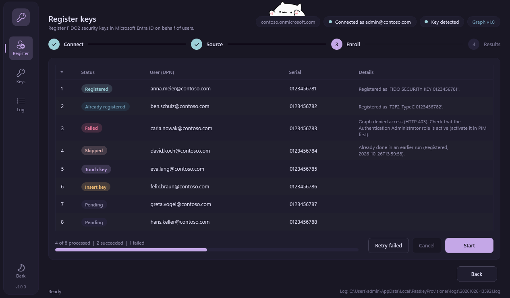
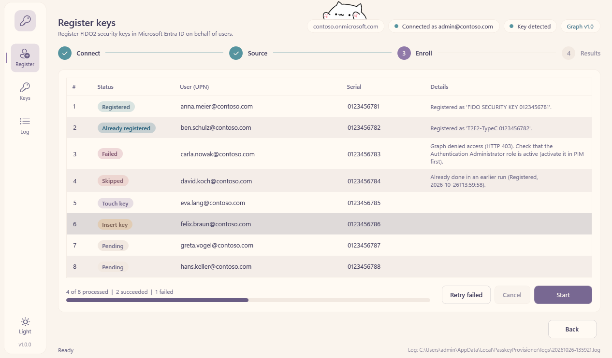

# Passkey Provisioner

A Windows tool for IT administrators to register FIDO2 hardware security keys (Token2 T2F2) in Microsoft Entra ID
on behalf of users, one at a time or in bulk from a CSV file. It runs as a standard user; no local admin rights are
required. Authentication happens interactively in the browser with delegated Microsoft Graph permissions.

Version 1.0. History: [docs/CHANGELOG.md](docs/CHANGELOG.md).

## Requirements

- Windows 10/11 with Windows PowerShell 5.1 (part of Windows; PowerShell 7 is only needed to build the EXE)
- Entra role *Authentication Administrator* or higher, consent for `UserAuthenticationMethod.ReadWrite.All`
- Internet access on first start: the pinned PowerShell modules (Microsoft Graph 2.39.0, DSInternals.Passkeys 3.2.0) are installed to the
  current user scope once, about 100 MB; this can take several minutes. Later starts need nothing.
- A default browser or the Windows account dialog for the Microsoft sign-in
- A FIDO2 key per user and a CSV with the columns `UPN,SerialID` for bulk mode (see `samples/users.sample.csv`)

## Repository layout

| Path | Purpose |
|---|---|
| `src/PasskeyProvisioner.Core/` | PowerShell module with all enrollment logic, no UI |
| `src/PasskeyProvisioner.App/` | WPF application |
| `src/Invoke-PasskeyProvisioner.ps1` | Headless runner, used for live tests |
| `tests/` | Pester 5 tests |
| `config/settings.sample.json` | Configuration template; copy to `config/settings.json` (untracked) |
| `docs/` | Changelog, module matrix, live test checklist, screenshots |
| `build/` | EXE build script (`Build-Exe.ps1`) and icon generator |

## Configuration

Copy `config/settings.sample.json` to `config/settings.json` and adjust the tenant. Module versions are pinned on
purpose; see [docs/MODULES.md](docs/MODULES.md) before changing them.

## Start the app

Double-click `PasskeyProvisioner.exe` (see [EXE](#exe)) or run the script:

```powershell
powershell.exe -NoProfile -ExecutionPolicy Bypass -File .\src\PasskeyProvisioner.App\Start-PasskeyProvisionerApp.ps1
```

The window comes in two themes, Rosé Pine (dark) and Rosé Pine Dawn (light), and three modes: **System** (the default:
follows the Windows app mode and changes with it), **Light** and **Dark**. The button at the bottom of the navigation rail
(or Ctrl+T) cycles through them; the choice is remembered. `-Theme System|Light|Dark` overrides it for one start.

| Dark (Rosé Pine) | Light (Rosé Pine Dawn) |
|---|---|
|  |  |

All screens in both themes: [docs/ui/](docs/ui/). Try it without a tenant or a key: add `-Simulate` (fake Graph and a fake key; remove or
re-insert the key by writing `0` or `1` into `%TEMP%\passkeyprovisioner-sim-key.txt`) or `-Demo` (static sample data).

## Logs and results

- Every run writes a log file to `%LOCALAPPDATA%\PasskeyProvisioner\logs` (configurable with `logDirectory`).
- CSV runs write a result file next to the CSV (`users.csv` becomes `users.result.csv`) after every row. Start the
  runner with `-Resume` to skip users that were already registered in an earlier run.

## Troubleshooting

| Symptom | Cause and fix |
|---|---|
| HTTP 403 when registering | The Authentication Administrator role is not active. Activate it in PIM and connect again. Users who hold admin roles themselves need *Privileged Authentication Administrator*. |
| "Assembly with same name is already loaded" | Two versions of a Graph module in one process. Close the app and start it again; never import other versions by hand. See [docs/MODULES.md](docs/MODULES.md). |
| The EXE disappears or does not start | Microsoft Defender may treat a compiled PowerShell tool as suspicious. Ask IT for an exclusion for the folder, or run the script instead. Startup errors are written to `%LOCALAPPDATA%\PasskeyProvisioner\startup-error.log`. |
| No sign-in window | The sign-in needs a window handle; the EXE creates a hidden console for it (see `spikes/README.md`). If it still does not appear, look in the log for "Window opened during sign-in". |
| Reset does not work | A key accepts a reset only in the first 10 seconds after it was inserted. Follow the countdown in the Keys view. |
## Development

```powershell
Import-Module Pester -MinimumVersion 6.0
Invoke-Pester -Path .\tests -Output Detailed
Invoke-ScriptAnalyzer -Path .\src -Recurse -Settings .\PSScriptAnalyzerSettings.psd1
```

## EXE

`pwsh -NoProfile -File build\Build-Exe.ps1` builds `dist\PasskeyProvisioner.exe` (needs the ps2exe module in PowerShell 7). The EXE
is a single file: it contains the app, unpacks itself to `%LOCALAPPDATA%\PasskeyProvisioner\app` on first start and needs no console.
An optional `settings.json` next to the EXE overrides the defaults. Check a build with
`powershell.exe -NoProfile -File .\tests\Invoke-UiSimulationTest.ps1 -ExePath .\dist\PasskeyProvisioner.exe`.

## License

GNU General Public License v3.0, see [LICENSE](LICENSE). Third-party material is listed in [THIRD-PARTY-NOTICES.md](THIRD-PARTY-NOTICES.md).

## Credits

- Colors: [Rosé Pine](https://github.com/rose-pine/palette) by the Rosé Pine contributors (MIT).
- Bongo cat: [Wreckstation/bongo-cat-for-streamers](https://github.com/Wreckstation/bongo-cat-for-streamers) (GPL-3.0). Bongo Cat was created by
  [StrayRogue](https://twitter.com/StrayRogue); the transparent artwork is by
  [mandash1996](https://www.deviantart.com/mandash1996/art/Bongo-Cat-Meme-764472620).
